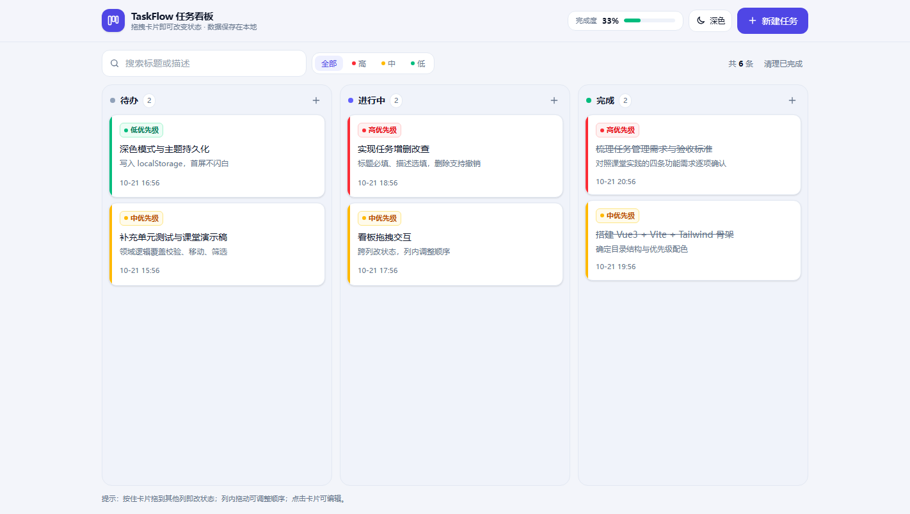
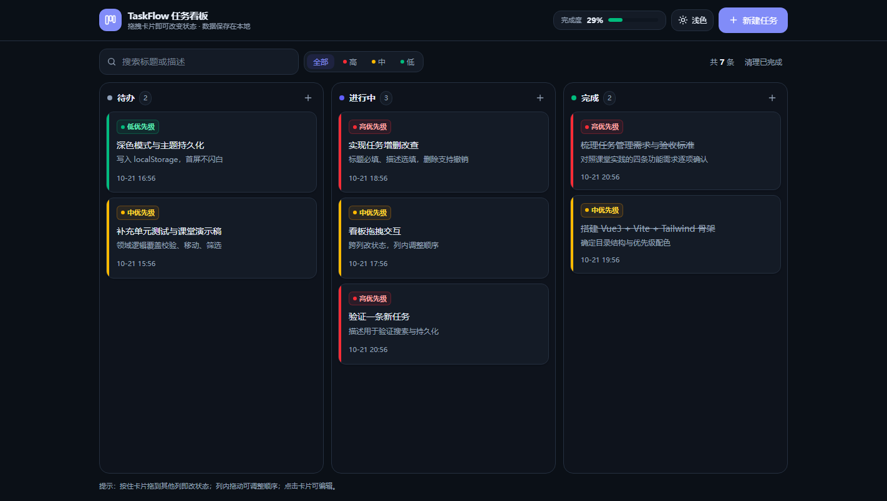

# TaskFlow · 任务看板

[](https://github.com/workwolfward/task-kanban/actions/workflows/ci.yml)
[](./LICENSE)


课堂实践交付物：用 Agentic 开发方式完成的任务管理应用。

技术栈：**Vue 3 + Vite + Tailwind CSS v4 + localStorage**（无后端、无第三方 UI 库）。





## 快速开始

```bash
npm install
npm run dev      # http://localhost:5173
npm run build    # 产物输出到 dist/
npm run preview  # 预览构建产物
npm test         # 单元测试（vitest，37 条）
```

### 演示与调试参数

- `?demo=1`：本地暂无数据时灌入 6 条示例任务（已有数据不覆盖），便于课堂演示
- `?theme=light` / `?theme=dark`：临时强制主题，不写入 localStorage

## 功能对照
| 需求 | 实现位置 | 说明 |
| --- | --- | --- |
| 任务增删改查 | `src/App.vue`、`src/components/TaskDialog.vue` | 标题必填、描述选填；删除有二次确认并支持撤销 |
| 三种状态 | `src/lib/tasks.js` → `STATUSES` | 待办 / 进行中 / 完成 |
| 优先级三档 | `src/components/TaskCard.vue` | 高=红、中=黄、低=绿，卡片左侧色条 + 标签 |
| 看板视图 | `src/components/TaskColumn.vue` | 三列卡片，列内与跨列拖拽均可改状态 / 排序 |
| 深色模式 | `src/App.vue`、`src/lib/storage.js` | 一键切换，写入 localStorage；首次访问跟随系统偏好 |
| 数据持久化 | `src/lib/storage.js` | 读写 `kanban.tasks.v1`，刷新不丢失；脏数据自动修复 |

### 额外补齐的可用性细节

- 搜索（标题 + 描述）与按优先级筛选
- 顶部完成度进度条、每列任务计数
- 无鼠标场景：卡片悬浮按钮「移到进行中 / 完成」，移动端同样可用
- 空列表引导、Toast 反馈、删除可撤销、`Esc` 关闭弹窗、`prefers-reduced-motion` 降级
- **多标签页同步**：另一个标签页改了任务或主题，当前页通过 `storage` 事件自动跟随
- **快捷键**：`N` 新建任务、`/` 聚焦搜索（在输入框内不抢键）
- **写入失败有反馈**：localStorage 被禁用或配额满时提示，而不是静默丢数据

## 开发过程（四轮迭代）

每轮都是「计划 → 执行 → 浏览器验证 → 提交」，仓库历史一个回合一个提交：

| 轮次 | 提交 | 做了什么 |
| --- | --- | --- |
| 1 | `086396f` | 工程骨架、语义色变量、三列静态布局 |
| 2 | `34cce98` | 领域纯函数 + 增删改查 + 标题必填校验 |
| 3 | `6085288` | localStorage 持久化与脏数据修复 |
| 4 | `463f735` | 拖拽看板、优先级配色、深色模式 |
| 收尾 | `339871c` | 多标签同步、快捷键、存储层测试、CI |

每个提交都能独立 `npm run build`；`git checkout 34cce98` 可以看到当时还没有持久化的版本。

## 目录结构

```
task-kanban/
├─ index.html                # 首帧前应用主题，避免深色模式闪白
├─ vite.config.js            # base: './' 便于静态托管
├─ .github/workflows/ci.yml  # push / PR 时跑测试与构建
├─ src/
│  ├─ main.js
│  ├─ style.css              # Tailwind + 主题 CSS 变量 + 组件类
│  ├─ App.vue                # 组合根：状态、持久化、拖拽、弹窗编排
│  ├─ lib/
│  │  ├─ tasks.js            # 领域纯函数（无 Vue / 无浏览器 API，可直接单测）
│  │  └─ storage.js          # localStorage 读写与主题应用
│  └─ components/
│     ├─ TaskColumn.vue
│     ├─ TaskCard.vue
│     ├─ TaskDialog.vue
│     └─ ConfirmDialog.vue
└─ tests/
   ├─ tasks.test.js          # 25 条：校验、CRUD、移动、筛选、脏数据
   └─ storage.test.js        # 12 条：读写、损坏数据降级、主题、写入失败
```

设计上的一个取舍：**业务规则全部收敛在 `lib/tasks.js` 的纯函数里**。组件只负责渲染和事件转发，因此「标题必填」「非法状态回落」「移动后时间戳更新」这类规则可以被测试直接锁定，不需要挂载组件。

## 数据格式

```json
{
  "id": "uuid",
  "title": "完成看板拖拽",
  "description": "支持跨列与列内排序",
  "status": "todo | doing | done",
  "priority": "high | medium | low",
  "createdAt": 1761000000000,
  "updatedAt": 1761000000000
}
```

`normalizeTaskList()` 在读取时会丢弃无标题记录、修复非法枚举值、为缺 id 的记录补 id、对重复 id 重新分配，避免历史脏数据让页面崩溃。

## 验证记录

```bash
$ npm test
✓ tests/storage.test.js (12 tests)
✓ tests/tasks.test.js (25 tests)
Tests  37 passed (37)

$ npm run build
✓ built in ~1s   # dist/index.html + assets
```

浏览器手测清单（对应课堂实践的「每轮确认」）：

1. 空标题点击创建 → 输入框下方提示「标题不能为空」，不产生卡片
2. 创建三条不同优先级任务 → 卡片颜色分别为红 / 黄 / 绿
3. 拖拽卡片到「进行中」「完成」→ 计数与进度条同步变化
4. 点击卡片修改描述、优先级、状态 → 保存后立即更新
5. 删除卡片 → 二次确认 → Toast 可撤销
6. 刷新页面 → 任务与主题全部保留
7. 切换深色模式 → 刷新后仍为深色
8. 开两个标签页 → 一边新建任务，另一边自动出现
9. 按 `N` 弹出新建窗口、按 `/` 聚焦搜索框

## 文档

- [`TASK.md`](./TASK.md)：任务单（目标 / 范围 / 约束 / 验收 / 停止条件）与四轮迭代记录
- [`docs/课堂实践报告.md`](./docs/课堂实践报告.md)：实践报告（提示词设计、验证证据、演示脚本）
- [`docs/screenshots/`](./docs/screenshots)：浅色 / 深色 / 弹窗 / 移动端截图
- [`LICENSE`](./LICENSE)：MIT
