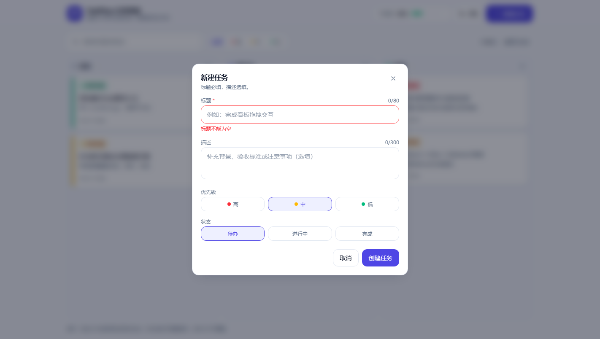

# 课堂实践报告：用 Agentic 开发完成一个任务管理应用

> 课程：基于 Agent 的软件开发（0922）
> 交付物：TaskFlow 任务看板（Vue 3 + Vite + Tailwind CSS + localStorage）
> 代码：`task-kanban/`　文档：`README.md`（使用说明）、`TASK.md`（任务单）、本报告

---

## 一、实践目标与交付结果

课堂实践要求用 Agentic 的方式，从零做出一个「能演示、能刷新、能验收」的任务管理应用。本次交付包含三部分：

| 交付物 | 位置 | 作用 |
| --- | --- | --- |
| 可运行应用 | `task-kanban/` | 满足全部六条功能需求 |
| 任务单与契约 | `TASK.md` | 把「做一个任务管理应用」变成可验收的小任务 |
| 验证证据 | `tests/`、本报告第四、五节 | 单测 37 条通过 + 构建通过 + 浏览器自动化断言 11 项 + CI |

功能核对（对照课件第 1 页）：

| 需求 | 是否完成 | 实现说明 |
| --- | --- | --- |
| 任务增删改查，标题必填、描述选填 | ✅ | 弹窗表单 + 前置校验，空标题不产生数据；删除二次确认且可撤销 |
| 三种状态：待办 / 进行中 / 完成 | ✅ | 单一 `status` 字段，三列看板直接映射 |
| 优先级三档：高红 / 中黄 / 低绿 | ✅ | 卡片左侧色条 + 优先级标签，颜色语义与筛选器一致 |
| 看板视图，拖拽改状态 | ✅ | HTML5 拖拽，支持跨列改状态与列内排序；另提供「移到下一列」按钮兜底触屏 |
| 深色模式，一键切换并记住 | ✅ | `class` 策略 + `localStorage`，首帧前内联脚本应用，避免闪白 |
| 数据存浏览器，刷新不丢失 | ✅ | `localStorage` 单一读写入口，读取时自动修复脏数据 |

截图（浅色看板 / 校验提示 / 深色模式）：





---

## 二、把「愿望」改写成任务单

课件反复强调：**第一个动作不是写代码，而是补齐任务契约**。所以先把课堂实践的四条要求写成任务单（完整版见 `TASK.md`）：

```yaml
goal: 一个无需后端、刷新不丢数据的任务看板
scope:
  - 仅前端单页应用；不使用后端、第三方 UI 库
  - 可写：src/、tests/、docs/
constraints:
  - 数据只存 localStorage，不引入网络请求
  - 不引入 UI 组件库（Tailwind 手写样式）
  - 每次只交付一个可验证的行为
acceptance:
  - 空标题无法创建（有可见提示）
  - 三列拖拽可改状态，计数与进度同步
  - 刷新后任务与主题均保留
  - npm test 全绿、npm run build 成功
stop_if:
  - 需要新增依赖才能完成需求 → 先停下确认
  - 单个文件改动超过 2 个模块 → 缩小任务
```

这份任务单在开发中真的起了作用：中途想加「拖拽库」（如 `vuedraggable`）时，`constraints` 里的「不新增依赖」直接否掉了这个方向，最后用原生 HTML5 拖拽 + 兜底按钮实现，包体保持在 103 kB（gzip 39 kB）。

---

## 三、项目骨架（第一轮）

先定结构与边界，再写业务。骨架阶段只产出目录和三条主线：领域逻辑、持久化、视图。

```
task-kanban/
├─ index.html                # 首帧前应用主题，避免深色模式闪白
├─ vite.config.js            # base: './'，可静态托管
├─ src/
│  ├─ App.vue                # 组合根：状态 / 持久化 / 拖拽 / 弹窗编排
│  ├─ lib/tasks.js           # 领域纯函数（不依赖 Vue 与浏览器）
│  ├─ lib/storage.js         # localStorage + 主题
│  └─ components/            # TaskColumn / TaskCard / TaskDialog / ConfirmDialog
├─ tests/
│  ├─ tasks.test.js          # 25 条用例：领域规则
│  └─ storage.test.js        # 12 条用例：持久化与主题
├─ .github/workflows/ci.yml  # push / PR 自动跑测试与构建
└─ docs/                     # 报告与截图
```

关键设计取舍：**业务规则全部收敛到 `lib/tasks.js` 的纯函数里**，组件只做渲染与事件转发。这样「标题必填」「非法状态回落默认值」「移动后更新时间戳」都能被测试直接锁定，不需要挂载组件、不需要浏览器。这是让 Agent 产出「可验证」而不是「看起来对」的前提。

---

## 四、四轮迭代：每轮都是「计划 → 执行 → 确认」

课件第 3 页要求分四步、每轮说清目标、执行、浏览器验证、提交。实际执行如下。

### 第 1 轮：骨架

- **本轮目标**：能跑起来的三列空看板，确定配色与目录。
- **执行**：写 `index.html`、`vite.config.js`、Tailwind v4 主题变量（`--canvas / --surface / --line / --ink`），深色模式用 `.dark` 类切换。
- **确认**：`npm run dev` 起服务，页面三列渲染正常，无控制台报错。
- **结论**：色板用 CSS 变量而不是散落的 `dark:` 前缀，后续所有组件只引用语义色（`bg-surface`、`text-ink-soft`），改主题只改一处。

### 第 2 轮：核心功能（增删改查）

- **本轮目标**：只做一件事——任务能被创建、编辑、删除，且标题必填。
- **执行**：`createTask / updateTask / deleteTask / validateTitle` 纯函数 + `TaskDialog` 表单。
- **确认**：浏览器实测空标题创建 → 输入框下方出现「标题不能为空」，卡片数量不变。
- **证据**：`error text: 标题不能为空`，`cards after create: 7`（见第五节断言表）。

### 第 3 轮：数据持久化

- **本轮目标**：刷新不丢；历史脏数据不能把页面搞崩。
- **执行**：`storage.js` 作为唯一读写入口；`normalizeTaskList()` 读取时丢弃无标题记录、修复非法枚举、补 id、处理重复 id。
- **确认**：创建任务后强制刷新，卡片仍在；手动把 `localStorage` 改成非法 JSON 也不白屏（降级为空列表）。
- **证据**：`cards after reload: 7`。

### 第 4 轮：看板交互与深色模式

- **本轮目标**：拖拽改状态、列内排序、深色模式一键切换并记住。
- **执行**：卡片 `draggable` → 列与卡片分别处理 `dragover / drop`，`beforeId` 决定插入位置；`moveTask()` 保证位置与状态都没变时返回原引用，避免无意义写盘。
- **确认**：拖到「进行中」后列计数与顶部进度同步；切深色后刷新仍为深色。
- **证据**：`toast move: 「验证一条新任务」已移到进行中`、`dark class: true`。

---

## 五、验证证据

### 1. 单元测试（领域规则）

```
$ npm test
✓ tests/storage.test.js (12 tests)
✓ tests/tasks.test.js (25 tests)
Test Files  2 passed (2)
     Tests  37 passed (37)
```

覆盖：标题校验（空 / 超长 / 正常）、默认值、非法状态回落、更新时标题置空则整次作废、跨列与列内移动、拖到自己身上的空操作、删除、计数分组、搜索与优先级组合筛选、脏数据修复；另外覆盖持久化层的写入 / 读回、损坏 JSON 降级、脏数据修复、主题偏好、写入失败返回 `false`。

### 2. 构建

```
$ npm run build
dist/index.html                   0.84 kB │ gzip:  0.56 kB
dist/assets/index-*.css          28.22 kB │ gzip:  6.24 kB
dist/assets/index-*.js          102.77 kB │ gzip: 39.02 kB
✓ built in 660ms
```

### 3. 浏览器端自动化确认（headless Chrome + CDP）

不靠肉眼，用脚本驱动真实浏览器点击并断言：

| # | 操作 | 期望 | 实际 |
| --- | --- | --- | --- |
| 1 | 打开看板 | 六条示例任务渲染 | `cards: 6` ✅ |
| 2 | 顶部进度 | 完成 2/6 | `完成度 33%` ✅ |
| 3 | 点击「新建任务」 | 弹窗出现 | `dialog visible: true` ✅ |
| 4 | 空标题点「创建任务」 | 提示且不建卡 | `标题不能为空` ✅ |
| 5 | 填标题 + 选「高」+ 创建 | 卡片+1 | `cards after create: 7` ✅ |
| 6 | 强制刷新 | 卡片仍在 | `cards after reload: 7` ✅ |
| 7 | 快捷移动按钮 | 状态变更 + 提示 | `「验证一条新任务」已移到进行中` ✅ |
| 8 | 点击卡片 | 编辑弹窗带原值 | 标题 10/80、描述 21/300 ✅ |
| 9 | 搜索「拖拽」 | 只留 1 张卡 | `cards after search: 1` ✅ |
| 10 | `?theme=dark` | 深色生效 | `dark class: true` ✅ |
| 11 | 390×844 视口 | 单列纵向排列，无横向滚动 | 见 `screenshots/05-mobile.png` ✅ |

---

## 六、提示词设计（Agentic 开发的关键）

实践里最有效的不是「写得更详细」，而是**给 Agent 可验证的边界**。下面四条是实际使用中效果最好的模板。

**1. 骨架阶段：先约束，再动手**

```
目标：为任务管理应用建立可运行骨架（Vue3 + Vite + Tailwind v4）。
约束：不引入 UI 组件库；主题色必须走 CSS 变量，组件里只允许用语义色类名。
产出：目录结构 + 一屏三列空看板。
先只给结构，不要写业务逻辑。
```

> 为什么要「先只给结构」：一次给全量需求，Agent 倾向一次写几百行，Review 时无法判断对错；限定产出后，第一轮 diff 只有 6 个文件、可逐行读完。

**2. 业务逻辑：把规则写成可断言的句子**

```
在 src/lib/tasks.js 里实现 createTask/updateTask/moveTask/deleteTask，
要求：
- 标题 trim 后为空则抛错，不产生数据；
- 非法 status/priority 回落默认值（todo/medium）；
- moveTask(tasks, id, toStatus, beforeId) 在 beforeId 为 null 时追加到列尾；
- 位置与状态都未变化时返回原数组引用。
不要修改任何 .vue 文件。
```

> 「返回原数组引用」这类要求会被直接写成测试用例，比「注意性能」有效得多。

**3. 交互：描述行为，不描述实现**

```
看板支持 HTML5 拖拽：跨列拖动改变 status；拖到某张卡片上时插入到它之前。
拖拽中卡片半透明并轻微倾斜，目标列边框高亮。
触摸设备无法拖拽，因此卡片悬浮时提供一个「移到下一列」按钮。
```

**4. 纠偏：把失败文本原样贴回去，并限定修改范围**

```
npm test 失败：
Expected: "B", "A", "C"  Received: "A", "B", "C"
moveTask 的插入位置算错了：beforeId 应该在移除自身之后再定位。
只修改 moveTask，其他不要动。
```

> 纠偏模板的三个要素：**贴原始报错**、**指出根因假设**、**限定修改范围**。
> 本次实践里真实的失败发生在验证环节（见第七节第 4 条）：页面还没渲染完就去断言，脚本报 `Cannot set properties of null`。处理方式同样是「贴日志 + 定位根因 + 只改一处（等待就绪而不是固定 sleep）」，一次修好。

---

## 七、遇到的问题与处理

| # | 问题 | 现象 / 根因 | 处理 |
| --- | --- | --- | --- |
| 1 | Tailwind v4 的 class 深色模式不生效 | v4 取消了 `tailwind.config.js` 的 `darkMode` 配置 | 在 CSS 里声明 `@custom-variant dark (&:where(.dark, .dark *))`，再用 `<html class="dark">` 切换 |
| 2 | 深色模式首屏闪白 | Vue 挂载后才读主题，首帧是浅色 | `index.html` 内联脚本在渲染前读 `localStorage` 并加 class |
| 3 | 同列拖拽插入点偏移 | 若先算插入下标、再从数组里移除自身，前移时下标会偏一位 | `moveTask` 先 `filter` 掉自身，再在剩余数组里定位 `beforeId`；测试用 `["B","A","C"]` 固定这个语义 |
| 4 | 自动化验证报 `Cannot set properties of null` | 固定 `sleep` 猜测加载时间，Vite 首次依赖预构建较慢时页面还没挂载 | 改为轮询 `document.querySelector('article, header h1')`，就绪后再断言与截图 |
| 5 | 触屏无法拖拽 | HTML5 拖拽不响应触摸事件 | 卡片悬浮/聚焦时提供「移到下一列」按钮，兼顾键盘可达 |
| 6 | 手改存储导致渲染错乱 | 重复 id 触发 Vue key 冲突、非法枚举落入未知列 | `normalizeTaskList()` 读取时补 id / 去重 / 回落默认值 |

第 3 条值得展开：它说明「把语义写进测试」的价值。需求里的「拖到某张卡前面」在实现上有两种理解（插入到该卡之前 vs 替换该卡），只有把断言写成 `["B","A","C"]` 才有唯一答案。

---

## 八、与课程知识点的对应

- **任务边界（目标 / 环境 / 停止条件）**：`TASK.md` 的 `stop_if` 就是停止条件；`constraints` 是权限边界。
- **感知—思考—行动—反馈**：每轮「写目标 → 改代码 → 跑测试/截图 → 看 diff 再决定下一步」，验证结果回流成下一轮的输入，正是课件第 19、47 页的闭环。
- **证据回流**：交付不是「我改好了」，而是 `npm test` 输出、构建体积、浏览器断言表。
- **工具边界**：只允许写 `src/`、`tests/`、`docs/`；装依赖属于「需要批准」，所以自始至终没有新增运行依赖。

---

## 九、交付前的工程化收尾

需求做完不等于可交付，以下是补齐的部分：

| 项 | 内容 | 为什么加 |
| --- | --- | --- |
| 边界修复 | 把卡片拖到自己身上视为空操作（原先会被追加到列尾） | 这是拖拽里最容易漏的一类「看起来没 bug」的问题，补了两条用例锁住 |
| 多标签页同步 | 监听 `storage` 事件，另一标签页的改动自动同步；用「上次写入的序列化结果」去重，避免来回写盘 | `localStorage` 共享，多开标签页是最常见的使用方式 |
| 写入失败反馈 | `saveTasks` 返回布尔值，配额满 / 隐私模式下弹提示 | 静默丢数据比报错更糟 |
| 快捷键 | `N` 新建、`/` 聚焦搜索，输入框内不抢键 | 演示时不用来回摸鼠标 |
| 持久化层测试 | 新增 `tests/storage.test.js`（12 条） | 之前只测了领域规则，存储层的降级路径没人看 |
| CI | `.github/workflows/ci.yml`：`npm ci → npm test → npm run build` | 让「测试通过」从口头承诺变成提交门禁 |
| 许可证 | MIT | 代码公开时明确授权 |

---

## 十、已知限制与后续

- 拖拽依赖 HTML5 DnD，触屏只能走按钮兜底；后续可用 Pointer Events 实现统一的拖拽手感。
- 数据只在单浏览器：多设备同步需要后端，属于本轮 `scope` 之外（也是 `stop_if` 里明确排除的）。
- 任务未做标签、截止日期、子任务；看板列宽固定三列，暂不支持自定义列。
- 尚未接入端到端测试框架，目前用一次性 CDP 脚本验证；后续可落成 Playwright 用例进 CI。

---

## 十一、5–10 分钟演示脚本

1. **空看板**（20s）：打开即三列，说明数据来自 `localStorage`，首次为空。
2. **创建 + 校验**（60s）：直接点「创建任务」→ 出现「标题不能为空」；再填标题、描述，优先级选「高」，创建 → 红色卡片出现在「待办」顶部。
3. **拖拽**（60s）：拖到「进行中」，列计数 +1、顶部进度更新；再拖到某张卡上方，演示列内排序。
4. **编辑与删除**（60s）：点卡片改优先级为「低」→ 色条转绿；删除 → 二次确认 → Toast 点「撤销」恢复。
5. **搜索与筛选**（30s）：搜索关键词、按优先级过滤。
6. **深色模式 + 刷新**（30s）：一键切换，刷新页面，任务与主题都还在。
7. **证据页**（60s）：`npm test` 37 passed、`npm run build` 成功、断言表 11 项通过，说明「为什么这些需求算完成」。
8. **收尾**（30s）：讲一个纠偏案例（`moveTask` 插入点），说明 Agent 出错时如何用测试与日志收敛。
